  

  
  
  

### Now

- **CTO & Full-Stack Developer at SpainU** (Lanzadera accelerator, Valencia): building the company's platform end to end, with Python backends and React frontends.
- **MSc in Telecommunications Engineering, UPC Barcelona**: thesis on sustainable AI at CTTC, graded 10/10.

### What I work on

- **Efficient deep learning**: profiling the energy and CO₂ cost of training and inference on Jetson boards, laptop GPUs and servers.
- **Multilingual NLP and GenAI**: LLM-RAG pipelines and Llama-based assistants in Catalan, Spanish and English.
- **Production AI services**: APIs and data pipelines that take models from notebooks to users.

### Tech I work with

<b>AI &amp; ML</b> 
  
  
  
  
  
  
  

<b>Backend</b> 
  
  
  
  
  

<b>Frontend</b> 
  
  
  
  

<b>Cloud &amp; DevOps</b> 
  
  
  
  
  
  

My experience, skills and a 3D view of my GitHub activity: <a href="https://sobhan-fld.github.io/cv/">sobhan-fld.github.io/cv</a>

